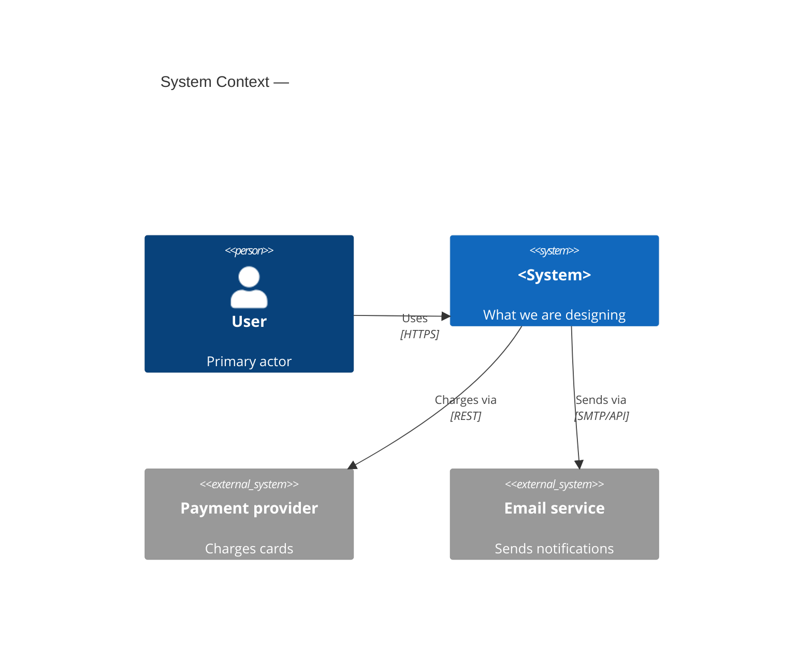
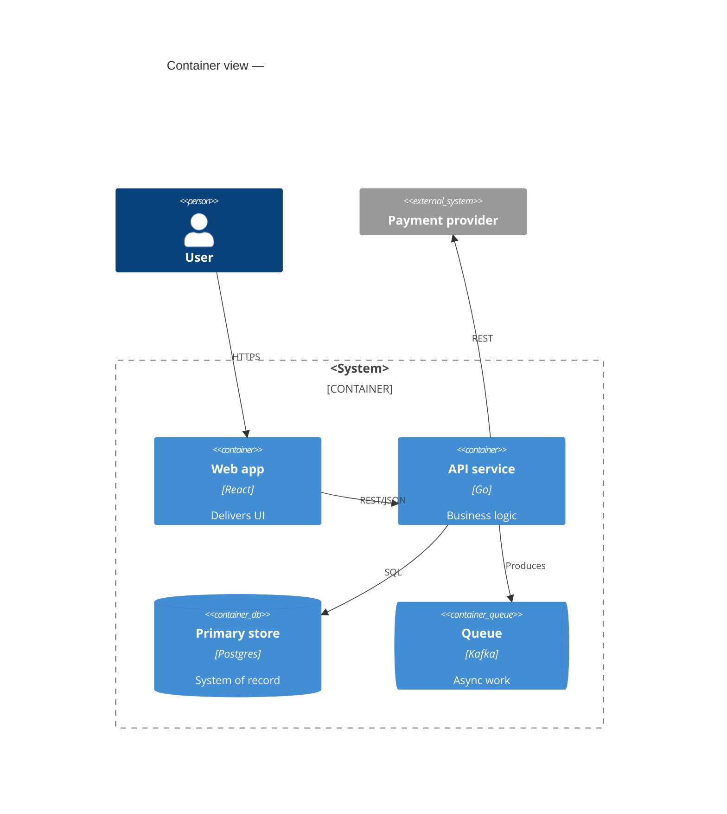

# C4 diagrams in Mermaid

Draw the architecture as C4 views rendered in Mermaid `C4Context`/`C4Container`
diagrams (or `flowchart` when the runtime lacks the C4 renderer). Two views are
enough for almost every design discussion; go deeper only for the one fragile
component.

## Level 1 — System Context

The system as one box against its actors and external systems. Purpose: agree
on scope before any internal detail exists.

## Level 2 — Container

The deployable/runtime units inside the system boundary and the protocols
between them. This is where step 3's "boxes and arrows" land.

## Rules

- One diagram per level; 8–15 nodes max. A crowded map means draw a zoom, not
  a bigger map.
- Label every arrow with protocol and direction (`Rel(a, b, "reads", "SQL")`);
  dashed for async/replication/fallback (`RelD`/`BiRel` variants, or `-.->` in
  flowchart fallback).
- Boundaries mark trust zones (`Container_Boundary`, `Enterprise_Boundary`),
  not decoration.
- Every box on the diagram must trace back to the decisions table — a
  component you cannot justify in solves/worsens/change-it-when terms does not
  get drawn.
- The diagram rides inside the design doc (`docs/design/<system>.md`), next to
  the decisions table it illustrates.
